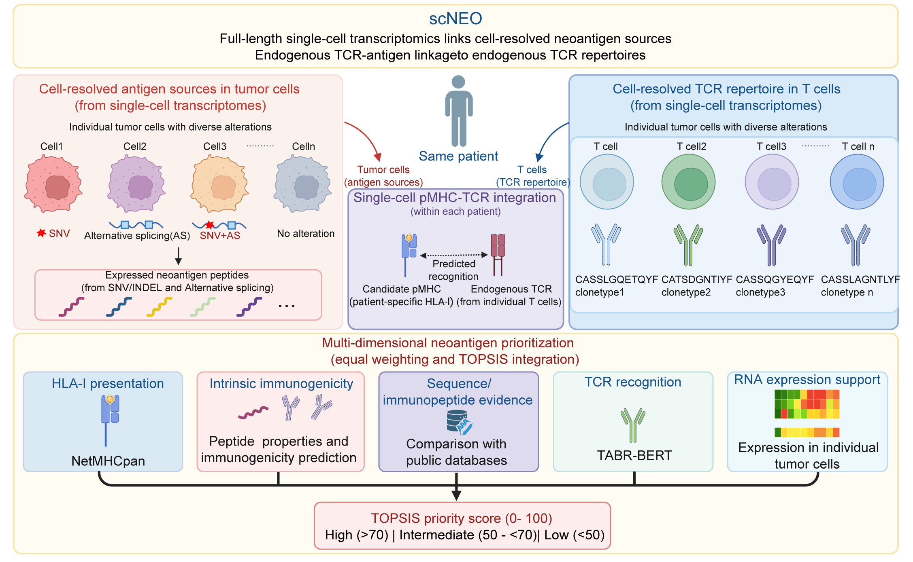

# sc-neo: A Nextflow Pipeline for Single-Cell Neoantigen Prioritization

## Project Overview

`sc-neo` is a Nextflow DSL2 workflow for discovering and prioritizing neoantigen candidates from Smart-seq2 single-cell transcriptomes. It combines RNA-sequencing evidence from each patient's tumor cells, normal cells, and T cells to identify peptides arising from somatic variants and aberrant splicing, then evaluates them using HLA-I presentation, expression, immunogenicity, and TCR-recognition evidence.



*Figure 1. The workflow links tumor-cell antigen sources with T-cell TCRs within each patient, then ranks neoantigen candidates using evidence from multiple dimensions.*

The workflow entry point is [`main.nf`](main.nf). Default parameters, container selectors, and execution profiles are defined in [`nextflow.config`](nextflow.config).

## Table of Contents

- [Feature Summary](#feature-summary)
- [Hardware Requirements](#hardware-requirements)
- [Installation](#installation)
- [Configuration and Usage](#configuration-and-usage)
- [Workflow Modules](#workflow-modules)
- [Output](#output)
- [Troubleshooting](#troubleshooting)

## Feature Summary

scNeo provides:
- End-to-end neoantigen discovery from full-length single-cell RNA-seq data
- Automated processing from raw sequencing data to prioritized neoantigen candidates
- Modular and reproducible workflow execution with Nextflow
- Patient-specific HLA-I typing and peptide presentation prediction
- Identification of mutation- and aberrant-splicing-derived neoantigens
- Optional immunopeptidome-based candidate filtering and annotation
- TCR reconstruction and pHLA–TCR recognition prediction
- Integration of multiple immunological evidence layers for neoantigen prioritization

## Hardware Requirements

Hardware needs depend on the number of patients and cells, sequencing depth, reference size, and the number of candidate peptides and TCRs. Adjust task resources and concurrency to the capacity available on your server or cluster. The values in [`nextflow.config`](nextflow.config) are configurable task requests, not fixed hardware requirements or benchmarked minimums.

| Resource | Data-dependent considerations | Configuration guidance |
| --- | --- | --- |
| CPU | More cells create more alignment and variant-calling tasks; candidate counts affect prediction workload. | Set per-task `cpus` for the tools that use threads, and limit concurrent tasks to the CPUs allocated to the workflow. |
| Memory | Genome indexes, read depth, pooled reads, and combined splicing matrices affect peak memory. | Set per-task `memory` from representative runs. Each task must fit on its execution node; reducing concurrency cannot compensate for insufficient memory for a single task. |
| Concurrency | Cell-level tasks can run in parallel, while pooled or cohort-level tasks may need larger allocations. | Tune `maxForks` for the relevant processes. Account for processes from different stages running simultaneously, and reserve capacity for the operating system and other workloads. |
| Disk and I/O | FASTQs, per-cell BAMs, references, temporary files, and retained task outputs grow with dataset size. | Provision space for both `work/` and published results. The default `copy` publishing mode stores published files separately; concurrent tasks also share storage bandwidth. |

Before a full run, use a representative subset that preserves the required tumor, normal, and T-cell groups. Review the execution trace, report, and storage usage, then adjust `cpus`, `memory`, and `maxForks` in a site-specific config such as `conf/local.config`. Reassess pooled and cohort-level steps when increasing the number of cells or patients, since their memory use may grow beyond that observed in the subset.

Check process labels in [`modules/`](modules/) when choosing which settings to override. On a shared server, size the workflow to the resources assigned to you; on a cluster, match task requests to node and queue limits. See [Advanced usage and execution reports](#advanced-usage-and-execution-reports) for a resource override example and reporting options.

## Installation

### Host environment

The installation commands below use a Linux host with Bash, Java, Nextflow, and either Apptainer or Singularity. Preparing the five local images also requires Docker and access to its daemon; Docker is not required to run the workflow with already prepared SIF images. Docker and Conda execution profiles are available with the additional configuration described below. The default executor is `local`; configure the executor, resources, and mounts for your cluster in a site-specific config file.

Use a Nextflow release that supports the workflow-level `publish:` and `output` syntax used in `main.nf`, with a compatible Java runtime. Check the installed executables before preparing a run:

```bash
java -version
nextflow -version
apptainer --version # or singularity --version
docker --version   # required for local image builds
docker info        # verify daemon access before building local images
```

### Container images

Run these commands from the project root, using the directory configured by `runtime_container_dir`:

```bash
(
set -e # stop this installation block if a build or pull fails
CONTAINER_RUNTIME=apptainer # or singularity
CONTAINER_DIR=/path/to/containers
mkdir -p "$CONTAINER_DIR"

for name in sc-neo-core sc-neo-align sc-neo-hla sc-neo-mafsmith sc-neo-altanalyze; do
  docker build -f "containers/${name}.Dockerfile" -t "${name}:local" .
  "$CONTAINER_RUNTIME" build "$CONTAINER_DIR/${name}.sif" "docker-daemon://${name}:local"
done

"$CONTAINER_RUNTIME" pull "$CONTAINER_DIR/vep.sif" docker://ensemblorg/ensembl-vep:release_112.0
"$CONTAINER_RUNTIME" pull "$CONTAINER_DIR/tabr-bert.sif" docker://freshwindbioinformatics/tabr-bert:v1
"$CONTAINER_RUNTIME" pull "$CONTAINER_DIR/s5_latest.sif" library://giovas/collection/s5
"$CONTAINER_RUNTIME" pull "$CONTAINER_DIR/trust4.sif" docker://quay.io/biocontainers/trust4:1.1.5--h5ca1c30_0
)
```

Set `CONTAINER_RUNTIME=singularity` to use Singularity. If the images are already installed, skip their build or pull commands.

The four externally sourced images are:

| Workflow image | Source |
| --- | --- |
| `s5_latest.sif` | scAllele image from `library://giovas/collection/s5`. |
| `vep.sif` | `ensemblorg/ensembl-vep:release_112.0`. |
| `trust4.sif` | The [upstream TRUST4 README](https://github.com/liulab-dfci/TRUST4) points to the Bioconda container on Quay: `docker://quay.io/biocontainers/trust4:1.1.5--h5ca1c30_0`. Save it under the filename expected by the workflow. |
| `tabr-bert.sif` | `freshwindbioinformatics/tabr-bert:v1`. |

The images do not constitute a complete prediction installation: netMHCpan and the external immunogenicity script must be prepared separately, and the TABR-BERT prediction interface and model assets must be checked before running. See [Locally supplied third-party software](#locally-supplied-third-party-software).

The `docker` profile enables Docker execution, but the process-specific container selectors still default to `.sif` paths. To use Docker, override those selectors with Docker image tags in your site config; setting `runtime_container` alone does not replace process-specific selectors. See [Python packages and native dependencies](#python-packages-and-native-dependencies) for the scope of the `conda` profile.

### Analysis tools and external models

| Tool | Role | Workflow image |
| --- | --- | --- |
| FastQC, fastp, STAR, samtools | Read QC, optional trimming, and alignment | `sc-neo-align.sif` |
| OptiType | Patient-level HLA-I typing | `sc-neo-hla.sif` |
| scAllele | Single-cell variant calling | `s5_latest.sif` |
| VEP | Offline variant annotation | `vep.sif` |
| mafsmith | VCF-to-MAF conversion | `sc-neo-mafsmith.sif` |
| AltAnalyze | Splicing matrix construction | `sc-neo-altanalyze.sif` |
| TRUST4 | TCR reconstruction | `trust4.sif` |
| featureCounts, BLAST, Python helpers | Expression, optional peptide comparison, and result processing | `sc-neo-core.sif` |
| netMHCpan, external immunogenicity script | MHC-I binding and immunogenicity evidence | External installations accessible from `sc-neo-core.sif` |
| TABR-BERT | TCR-recognition prediction | `tabr-bert.sif` |

### Locally supplied third-party software

Prepare the following software on storage accessible to the compute nodes. With container execution, the tools must run **inside their task container**; installing them only on the host `PATH` is insufficient. These prediction stages are connected in `main.nf` and have no dedicated skip switches.

| Software or asset | What to prepare locally | Configuration |
| --- | --- | --- |
| netMHCpan | Standalone executable, its complete model/data distribution, and a configured launcher | `tool_mhc_predictor_cmd`; optional `tool_mhc_predictor_extra_args` |
| IEDB-compatible class I immunogenicity predictor | External Python scoring script and any sibling modules/data it imports | `ref_immunogenicity_script`; interpreter selected by `tool_python_cmd` |
| TABR-BERT | A working prediction command and trained model assets in, or mounted into, `tabr-bert.sif` | `tool_tcr_recognition_cmd`; optional `tool_tcr_recognition_extra_args` |
| Reference databases | STAR index, genome/annotation, VEP cache, variant databases, splicing controls, and TRUST4 references | The `ref_*` parameters listed under [Reference resources](#reference-resources) |

#### Tool paths and container mounts

For example, merge the following settings into `conf/local.config`, replacing the paths with your installations:

```groovy
params {
    tool_mhc_predictor_cmd = '/opt/scneo-tools/netMHCpan/netMHCpan'
    ref_immunogenicity_script = '/opt/scneo-tools/iedb/predict_immunogenicity.py'
    tool_tcr_recognition_cmd = '/opt/scneo-tools/tabr-bert/tabr_bert_predict'
}

apptainer.runOptions = '-B /opt/scneo-tools:/opt/scneo-tools'
singularity.runOptions = '-B /opt/scneo-tools:/opt/scneo-tools'
```

Preserve any other bind mounts already needed by your site. These settings supplement the reference configuration in [Reference resources](#reference-resources); they are not a complete run configuration.

#### netMHCpan setup

Obtain the standalone package through the [official DTU netMHCpan page](https://services.healthtech.dtu.dk/services/NetMHCpan-4.1/) under the terms applicable to your use. Install the executable and data files following the package's instructions, and configure its launcher to locate the installation and a writable temporary directory. The entire installation must be visible at the paths used by the launcher inside `sc-neo-core.sif`.

The workflow invokes a netMHCpan-compatible command with `-BA -p <peptides.txt> -a <alleles> -s` and a peptide-length argument. Its parser expects peptide, allele, binding-affinity, and EL-rank columns from the text output. Check compatibility with the actual installed release; the repository does not pin a netMHCpan version. `tool_mhc_predictor_cmd` must be one executable path, with additional options supplied through `tool_mhc_predictor_extra_args`.

The core image supplies `tcsh`, but netMHCpan itself and its data are external. Launcher environment variables and paths must be set according to the installed package; configuring a host environment alone does not verify container execution.

Test an actual prediction inside the core image after installation:

```bash
CONTAINER_RUNTIME=apptainer # or singularity
CONTAINER_DIR=/path/to/containers
CHECK_DIR=$(mktemp -d)
printf '%s\n' NLVPMVATV GILGFVFTL > "$CHECK_DIR/peptides.txt"
"$CONTAINER_RUNTIME" exec \
  -B /opt/scneo-tools:/opt/scneo-tools \
  -B "$CHECK_DIR:/scneo-check" \
  "$CONTAINER_DIR/sc-neo-core.sif" \
  /opt/scneo-tools/netMHCpan/netMHCpan \
  -BA -p /scneo-check/peptides.txt -a HLA-A02:01 -l 9 -s
```

Inspect the output for affinity and EL-rank predictions. The workflow's default candidate filters require both `Aff.nM < 150` and `rank_EL < 2`.

#### IEDB immunogenicity script

Obtain the local predictor from the [IEDB Class I Immunogenicity resource](https://tools.iedb.org/immunogenicity/) using its Download link. Set `ref_immunogenicity_script` to the downloaded or adapted predictor, **not** to this repository's `bin/predict_immunogenicity.py`, which is the integration wrapper.

The wrapper runs `python3 <external_script> <peptides.txt>` by default. The input contains one peptide per line; the expected standard output is comma-separated, with peptide sequence in column 1 and immunogenicity score in column 3. Ensure the external script and its dependencies work with the configured interpreter (Python 3.11 in the core image). Keep imported modules and data accessible when Nextflow stages the script into a task directory. See [`bin/predict_immunogenicity.py`](bin/predict_immunogenicity.py) for the exact parsing contract.

#### TABR-BERT prediction interface

The configured command must accept `<input.tsv> <output.tsv>` as its first two positional arguments, followed by `tool_tcr_recognition_extra_args`. Input columns are `patient_id`, `peptide`, `hla_allele`, `cdr3_beta_aa`, and `tcr_cell_id`. The output must retain the first four matching-key columns and provide a numeric score column such as `max_TABR_BERT_rank` or `rank`; the workflow selects the maximum value per patient/peptide/HLA combination.

Check that the downloaded image contains the required entry point and trained model files. If its native command uses a different interface, supply an adapter through `tool_tcr_recognition_cmd`. The repository contains the calling interface in [`bin/predict_tcr_recognition.py`](bin/predict_tcr_recognition.py), but no TABR-BERT model installer or training weights. Install any model-specific Python dependencies in the TABR-BERT execution environment.

### Python packages and native dependencies

When using the supplied SIF images, helper packages run inside the containers and do not need a duplicate host installation. For local helper execution, prepare an environment consistent with [`containers/sc-neo-core.Dockerfile`](containers/sc-neo-core.Dockerfile):

| Dependency | Version in the core image definition | Purpose |
| --- | --- | --- |
| Python | `3.11` | Workflow helper scripts and external immunogenicity-script invocation |
| anndata, numpy, pandas, h5py | `0.10.8`, `1.26.4`, `2.2.3`, `3.12.1` | H5AD control data and tabular/numerical dependencies |
| pysam, biopython | Unpinned | Sequence/reference handling dependencies |
| samtools, bcftools, htslib | `1.19` | BAM/VCF and indexed-reference operations |
| BLAST+, Subread | `2.15.0`, unpinned | `blastp`/`makeblastdb` and `featureCounts` |
| tcsh | Distribution package | Shell support for external tool launchers |

The `conda` profile declares Python, anndata, pandas, numpy, h5py, pysam, biopython, Subread, and BLAST. It does not install the complete workflow toolchain. For a run without containers, also install the analysis executables in the tool table, their own runtime dependencies, and the external predictors above. TOPSIS scoring is implemented in Python in this repository and does not require a separate TOPSIS package.

## Configuration and Usage

### Reference resources

Copy [`conf/reference_template.config`](conf/reference_template.config) and replace its example paths with paths available in your environment:

```bash
cp conf/reference_template.config conf/local.config
```

Edit the copied file before running. The template sets `enable_immunopeptidome_compare = true` and provides an example TCGA control path. If these optional resources are unavailable, set `enable_immunopeptidome_compare = false` and `ref_splice_tcga_control_h5ad = null`. Set `runtime_container_dir` to the directory containing the prepared SIF images.

The workflow requires the following reference parameters at startup:

| Parameter | Resource |
| --- | --- |
| `ref_star_index` | STAR genome index. |
| `ref_genome_fasta` | Genome FASTA; the `.fai` index beside it is also required. |
| `ref_genome_gtf`, `ref_protein_fasta` | Gene annotation GTF and protein FASTA. |
| `ref_splice_gtex_h5ad` | GTEx splicing-control H5AD. |
| `ref_splice_exon_table`, `ref_splice_transcript_table` | AltAnalyze exon and transcript reference tables. |
| `ref_splice_reference_gtf`, `ref_splice_start_codon_table` | References for splicing translation phase and start codons. |
| `ref_vep_cache_dir` | Offline VEP cache. |
| `ref_dbsnp_vcf`, `ref_cosmic_vcf` | dbSNP and COSMIC VCFs for VEP; each index defaults to a neighboring `.tbi` file. |
| `ref_trust4_sequence`, `ref_trust4_imgt` | TRUST4 sequence and IMGT references. |
| `ref_immunogenicity_script` | External immunogenicity prediction script. |

`ref_splice_tcga_control_h5ad` is an optional additional splicing control. To enable immunopeptidome comparison, set `enable_immunopeptidome_compare = true` and provide `ref_immunopeptidome_healthy_tsv` and `ref_immunopeptidome_tumor_tsv`. Reference resources must match the genome and annotation versions used by the workflow. The template uses GRCh38 and Ensembl release 112 as examples.

Containers must be able to access the FASTQ files, reference resources, image directory, Nextflow work directory, and output directory. Add Apptainer/Singularity bind mounts in `conf/local.config` when site defaults do not cover these paths. Configure site-specific tool locations with `tool_*_cmd` and additional arguments with `tool_*_extra_args`.

### Input manifest

The input is a tab-separated TSV with one row per cell and these required columns:

```tsv
patient_id	cell_id	cell_type	fastq_1	fastq_2
P001	Tumor_001	tumor	/data/P001/Tumor_001_R1.fastq.gz	/data/P001/Tumor_001_R2.fastq.gz
P001	Normal_001	normal	/data/P001/Normal_001_R1.fastq.gz	/data/P001/Normal_001_R2.fastq.gz
P001	Tcell_001	tcell	/data/P001/Tcell_001_R1.fastq.gz	/data/P001/Tcell_001_R2.fastq.gz
```

- `cell_type` must be `tumor`, `normal`, or `tcell`. Each `cell_id` must be globally unique and must not contain a period (`.`).
- The `fastq_2` column must be present. By default, `allow_single_end_reads = true`, so leave its value empty for single-end data. The workflow infers read layout from whether this value is empty.
- Each patient must have at least three cells of each type by default. Adjust `threshold_min_cells_per_type` to change this minimum.
- Tumor and normal reads from the same patient must use the same layout. All T-cell reads in a TRUST4 batch must also use the same layout.

The three rows above illustrate the format only; a run with the default minimum requires at least three tumor, three normal, and three T cells per patient. Use one FASTQ path per read column rather than comma-separated lane lists.

### Run the workflow

After configuring references and containers, run from the project root:

```bash
CONTAINER_RUNTIME=apptainer # or singularity
nextflow run main.nf \
  -profile "$CONTAINER_RUNTIME" \
  -c conf/local.config \
  --input_manifest manifest.tsv \
  --output_dir results \
  -work-dir work \
  -resume
```

Set `CONTAINER_RUNTIME` to either `apptainer` or `singularity`; the executable and Nextflow profile then match. The `docker` and `conda` profiles are also available with their respective setup. Single-end reads are allowed by default; fastp trimming and immunopeptidome comparison are disabled by default. To resume an interrupted run, use the same inputs and configuration with `-resume`. For cluster execution, override the executor and resources in your site config.

Commonly adjusted parameters are listed below. See [`nextflow.config`](nextflow.config) for all defaults.

| Parameter | Default | Description |
| --- | --- | --- |
| `output_dir` | `results` | Root directory for published outputs. |
| `output_publish_mode` | `copy` | Nextflow output publishing mode. |
| `enable_read_trimming` | `false` | Run fastp read trimming. |
| `allow_single_end_reads` | `true` | Allow an empty `fastq_2` value. |
| `threshold_min_cells_per_type` | `3` | Minimum cells of each type per patient. |
| `threshold_min_tumor_variant_cells` | `3` | Minimum tumor cells supporting a recurrent variant. |
| `threshold_variant_enrichment_fdr` | `0.1` | FDR threshold for tumor/normal variant enrichment. |
| `threshold_population_af_max` | `0.001` | Maximum population allele frequency. |
| `threshold_splice_gtex_n_max` | `3` | Maximum control splicing mean; the filter uses a strict less-than comparison. |
| `threshold_splice_gtex_t_min` | `20` | Minimum tumor count minus control mean; the filter uses a strict greater-than comparison. |
| `threshold_splice_min_reads` | `3` | Minimum reads supporting a splicing event. |
| `threshold_mhc_affinity_max` | `150` | netMHCpan `Aff.nM` limit; the filter uses a strict less-than comparison. |
| `threshold_mhc_rank_el_max` | `2` | netMHCpan `rank_EL` limit; the filter uses a strict less-than comparison. |
| `enable_immunopeptidome_compare` | `false` | Compare peptides with healthy and tumor immunopeptidome references. |
| `enable_strict_splice_phase` | `false` | Keep only splicing translation frames supported by phase evidence. |
| `enable_splice_exclude_documented_junctions` | `false` | Exclude splicing events recorded in the transcript table. |

### Advanced usage and execution reports

Enable trimming and save Nextflow execution reports alongside the published outputs:

```bash
mkdir -p results/reports
nextflow run main.nf \
  -profile apptainer \
  -c conf/local.config \
  --input_manifest manifest.tsv \
  --output_dir results \
  --enable_read_trimming true \
  -with-report results/reports/execution_report.html \
  -with-timeline results/reports/execution_timeline.html \
  -with-trace results/reports/execution_trace.txt \
  -resume
```

For cluster execution, set `process.executor` and the relevant queue settings in your site config. Override resources using the existing labels, for example:

```groovy
process {
    withLabel: mem_high_threaded {
        cpus = 16
        memory = 128.GB
        maxForks = 2
    }
}
```

Resource settings belong in the Nextflow config. This workflow does not implement generic `--max_cpus`, `--max_memory`, `--skip_dna`, or `--skip_rna` parameters, or a custom `--help` handler. Its inputs are single-cell RNA reads, and its prediction branch targets HLA class I.

## Workflow Modules

| Module | Main tasks | Published directory |
| --- | --- | --- |
| Input and alignment | Manifest validation, FastQC/fastp, STAR alignment, and cell QC. | `01_qc/` |
| HLA typing | Pool patient reads and run OptiType. | `02_hla/` |
| Variant analysis | scAllele calls, recurrence and enrichment filters, VEP annotation, and MAF processing. | `03_variants/` |
| Splicing analysis | AltAnalyze matrix processing, background filtering, and candidate generation. | `04_splicing/` |
| Peptide generation | Variant and splicing peptides, plus optional immunopeptidome comparison. | `05_peptides/` |
| MHC prediction | Patient-specific prediction and MHC-I candidate filtering. | `06_mhc/` |
| TCR analysis | TRUST4 assembly and CDR3 beta-chain parsing. | `07_tcr/` |
| Expression and scoring | featureCounts expression, immunogenicity, and TABR-BERT predictions. | `08_scoring/` |
| Integration and ranking | Evidence integration, workflow summary, and TOPSIS prioritization. | `09_prioritization/` |

Nextflow processes and Python helper scripts are organized in [`modules/`](modules/) and [`bin/`](bin/), respectively.

## Output

All published outputs are written under `output_dir`. Stage directories contain `deliverables/` for primary results and `intermediate/` for intermediate files. The final ranked table is:

```text
results/09_prioritization/deliverables/final_candidate_neoantigens.tsv
```

Other key outputs include:

- `01_qc/deliverables/`: validated manifest, sample summary, and cell QC; alignment BAMs and STAR logs are under `01_qc/intermediate/`.
- `02_hla/deliverables/`: patient HLA types; raw OptiType outputs are under `02_hla/intermediate/`.
- `03_variants/deliverables/`: somatic mutation candidates; variant calls, recurrence results, and annotations are under `03_variants/intermediate/`.
- `04_splicing/deliverables/`: normalized splicing matrix and filtered splicing events.
- `05_peptides/deliverables/`: immunopeptidome-filtered or bypassed peptides and evidence; generated peptides and rejection records are under `05_peptides/intermediate/`.
- `06_mhc/deliverables/`: mutation and splicing MHC predictions and filtered pMHC candidates.
- `07_tcr/deliverables/`: TCR beta-chain CDR3 results.
- `08_scoring/deliverables/`: expression support, immunogenicity, and TABR-BERT predictions.
- `09_prioritization/intermediate/`: `integrated_candidate_neoantigens.tsv` and patient-specific candidate files.
- `09_prioritization/deliverables/`: the final ranked table and `pipeline_summary.tsv`.

The Nextflow work directory defaults to `work/`. It stores task cache files used by `-resume`; retain both the work directory and `.nextflow/` cache to resume tasks. Set `--output_dir` to publish results elsewhere. The `reports/` directory is generated only when the corresponding Nextflow reporting options are supplied, as in the advanced usage example.

## Troubleshooting

| Symptom | Checks |
| --- | --- |
| Missing `--input_manifest` or `ref_*` parameter | Pass the manifest on the command line and configure all required reference resources in `conf/local.config`. |
| Manifest validation reports missing columns, missing FASTQ files, or too few cells | Confirm the file is tab-separated, required column names are exact, and FASTQ paths are readable. Check that each patient has enough `tumor`, `normal`, and `tcell` rows. |
| `mixed read layouts` or a TRUST4 layout error | Check that `fastq_2` is consistently populated or empty across tumor and normal cells for each patient, and that all T cells use the same single-end or paired-end layout. |
| A container image cannot be found | Check that `runtime_container_dir` points to the directory containing the required `.sif` files, especially `s5_latest.sif`, `vep.sif`, `trust4.sif`, and `tabr-bert.sif`. |
| `command not found` or an external model fails to start | Check whether the relevant `tool_*_cmd` points to an executable visible inside the task container. Install and mount licensed tools, models, and references as required. |
| FASTQ or reference files are missing inside a container | Confirm bind mounts cover the manifest paths, references, work directory, output directory, and image directory. Prefer absolute paths that are identical inside and outside the container. |
| A task fails without enough detail in the Nextflow summary | Inspect `.nextflow.log` and the task's `work/<task-hash>/.command.err` and `.command.log` files to identify the failing process and external command. |
| A task exits after running out of memory or CPU | Adjust the resources associated with process labels in `conf/local.config` for your executor. Default resources and concurrency limits are defined in `nextflow.config`. |
